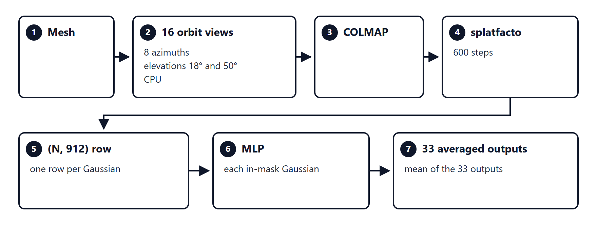
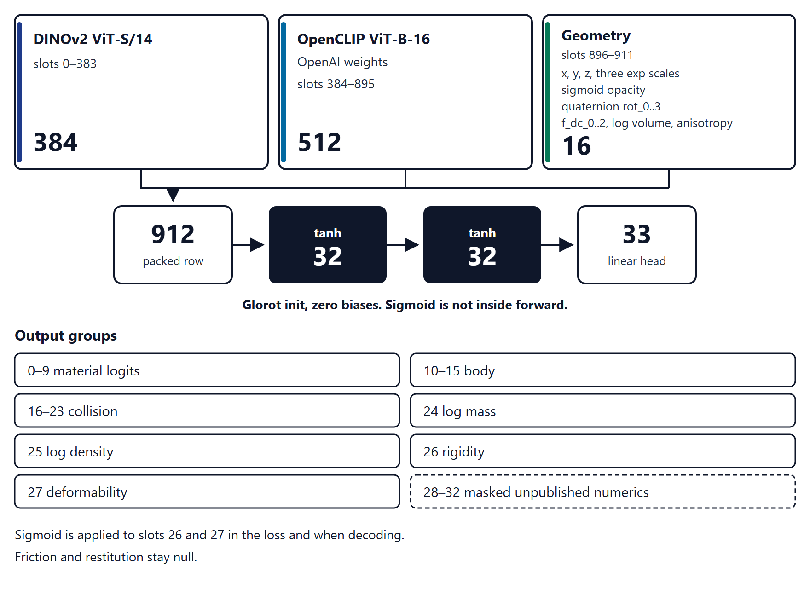
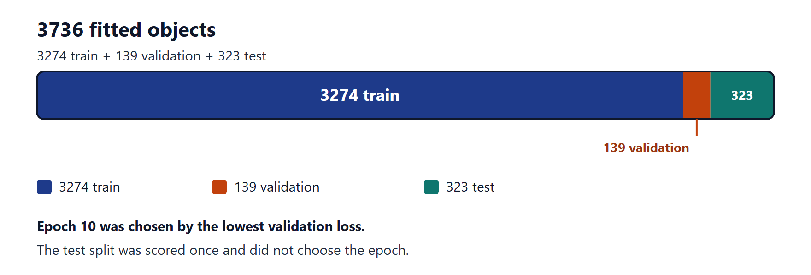
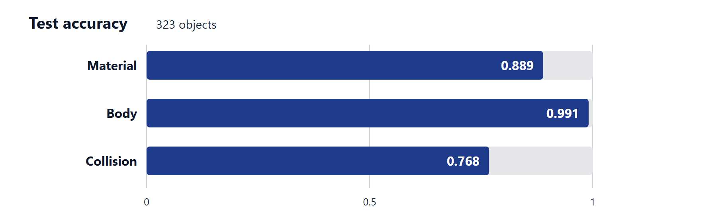

# Physics-prior MLP

Author: [sandy-t-shelvan](https://github.com/sandy-t-shelvan)

A per-Gaussian MLP predicts physical attributes from a fitted 3D Gaussian splat. The weights were trained in this project. They correspond to SceneAgent section 3.4 (Hollis, Fan, and Yang, [arXiv:2610.34745](https://arxiv.org/abs/2610.34745)). They are not a released third-party checkpoint.

The PDF is [`paper/physics_prior_mlp.pdf`](paper/physics_prior_mlp.pdf). The checkpoint is [`data/mlp/physics_prior_splat.npz`](data/mlp/physics_prior_splat.npz).

A two-page design for using this prior with NVIDIA PhysX and PhysGaussian is [`paper/mlp_physx_physgaussian.pdf`](paper/mlp_physx_physgaussian.pdf). That joint system has not been run.

## Pipeline



*Mesh to 16 CPU orbit views, COLMAP, splatfacto (600 steps), a packed (N, 912) row, the MLP, and 33 averaged outputs.*

A mesh is rendered as 16 CPU orbit views: 8 azimuths, at elevations 18° and 50°. COLMAP follows, and splatfacto fits the splat for 600 steps. Each Gaussian is packed into one row of width 912. Labels came from gemini-3.8-flash at temperature 0, with thinking set to low.

## Network



*The fitted-splat MLP: 912 inputs, two tanh hidden layers of width 32, and 33 outputs.*

The input width is 912. Two hidden layers of 32 use tanh. The output width is 33. Weights use Glorot init and biases start at zero. Sigmoid is not inside forward; it is applied to rigidity and deformability (slots 26 and 27) in the loss and when decoding.

Input layout:

- 0–383: DINOv2 ViT-S/14 (384)
- 384–895: OpenCLIP ViT-B-16, OpenAI weights (512)
- 896–911: geometry (x, y, z, three exp scales, sigmoid opacity, quaternion rot_0..3, f_dc_0..2, log volume, anisotropy)

Outputs:

- 0–9 material logits
- 10–15 body
- 16–23 collision
- 24 log mass
- 25 log density
- 26 rigidity
- 27 deformability
- 28–32 masked unpublished numerics

Friction and restitution stay null.

Inference runs the MLP on each in-mask Gaussian, then averages the 33 outputs. A class tie returns no class. An unknown class has its weight multiplied by 0.4.

## Split



*3736 fitted objects split into 3274 train, 139 validation, and 323 test. Epoch 10 was chosen by validation loss.*

This checkpoint is 14 epochs. The saved weights are epoch 10, the lowest validation loss. The fitted set has 3736 objects: 3274 train, 139 validation, and 323 test. The test split was scored once and did not choose the epoch.

## Scores



*Test accuracy: material 0.889, body 0.991, collision 0.768.*

Scores of the saved checkpoint. Material, body, and collision are accuracies. Log mass, log density, rigidity, and deformability are mean absolute error. The table shows three decimals. [`data/mlp/train_report_splat.json`](data/mlp/train_report_splat.json) stores the full values.

| Split | Loss | Material accuracy | Body accuracy | Collision accuracy | Log-mass MAE | Log-density MAE | Rigidity MAE | Deformability MAE |
| --- | ---: | ---: | ---: | ---: | ---: | ---: | ---: | ---: |
| Train | 1.350 | 0.953 | 0.993 | 0.831 | 0.292 | 0.494 | 0.035 | 0.033 |
| Validation | 2.293 | 0.928 | 0.957 | 0.820 | 0.383 | 0.577 | 0.051 | 0.047 |
| Test | 2.088 | 0.889 | 0.991 | 0.768 | 0.352 | 0.572 | 0.037 | 0.035 |

## Files

Meshes and per-Gaussian `prior_input.npy` files are not in this repository. `physics_prior.npz` is not this model. [`data/mlp/physics_prior_splat_holdout462.npz`](data/mlp/physics_prior_splat_holdout462.npz) is a 30-epoch file and is not this checkpoint.

## Read the stored scores

Printing the report does not load feature files:

```python
import json
from pathlib import Path

report = json.loads(Path("data/mlp/train_report_splat.json").read_text(encoding="utf-8"))
print(report["epochs_ran"], report["checkpoint_epoch"], report["n_fitted"])
print(report["train"])
print(report["validation"])
print(report["test"])
```

To recompute those scores, put the repository root on `PYTHONPATH` and call `score_split`. Each row needs `material`, `body_type`, `collision`, `log_mass`, `log_density`, `rigidity`, `deformability`, and `prior_input` pointing at a local `(N, 912)` array. Those arrays are not in this repository. `score_split` runs the MLP on every Gaussian and averages the 33 outputs. It does not average the 912 inputs, and it does not train.

```python
from sceneagent.mlp.prior import PhysicsPrior
from sceneagent.mlp.train_prior import score_split

prior = PhysicsPrior.load("data/mlp/physics_prior_splat.npz")
print(score_split(prior, rows))
```

Loading and scoring need NumPy. The contract, view, and training tests are `tests/sceneagent/test_mlp_contract.py`, `tests/sceneagent/test_mlp_views.py`, and `tests/sceneagent/test_mlp_stratified.py`.
